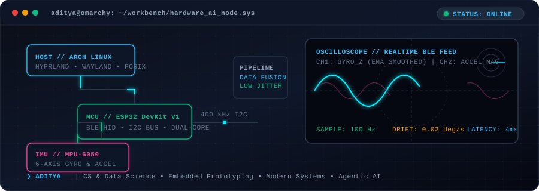

<div align="center">

<!-- Bespoke Animated Hardware & Oscilloscope Vector Banner -->


<br/>

[](https://education.github.com)
[](https://archlinux.org)
[](https://espressif.com)
[](https://python.org)

</div>

---

### 🧱 Engineering Bento Grid

<table>
<tr>
<td width="50%" valign="top">

#### 🔌 01 // Embedded Hardware & Firmware
* **ESP32 BLE Air Mouse**: Built a custom gesture mouse translating 6-axis IMU data into smooth HID cursor events over Bluetooth Low Energy.
* **Bus Protocols**: Hands-on I2C clock sync (400 kHz) and sensor polling with MPU-6050.
* **Hardware Prototyping**: Raspberry Pi SBC computing, breadboard circuit logic, tactile interrupts.

</td>
<td width="50%" valign="top">

#### 🐧 02 // Systems & Linux Environment
* **Daily Driver**: Arch Linux running Wayland compositor (Hyprland).
* **CLI & Tooling**: POSIX shell scripting, fast keyboard-driven workflows, Vim/Neovim, Git version control.
* **Low-Level Thinking**: Process isolation, file descriptors, signals, and system internals.

</td>
</tr>
<tr>
<td width="50%" valign="top">

#### 🐍 03 // Algorithmic Engineering
* **Foundational Problem Solving**: Writing algorithmic logic from blank files without external libraries.
* **Core Domains**: Digit arithmetic, recursion, string pattern algorithms, data structures (Lists, Hash Maps, Sets).
* **Target**: Clean time-space complexity and robust modular code.

</td>
<td width="50%" valign="top">

#### 🤖 04 // Agentic AI & Modern Workflows
* **Local Inference**: Experimenting with edge LLM execution via Ollama.
* **Agentic Tooling**: Using AI agents and Model Context Protocol (MCP) to automate software iteration cycles.
* **Vision**: Bridging physical embedded sensors with autonomous intelligent agents.

</td>
</tr>
</table>

---

### 🔬 Hardware Spotlight: ESP32 Bluetooth Air Mouse

<details>
<summary><b>🔍 Click to expand Circuit Wiring & Signal Flow Architecture</b></summary>
<br/>

```text
  [ PHYSICAL INPUT ]           [ EMBEDDED CONTROLLER ]              [ BLUETOOTH BLE ]            [ HOST OS ]
 ┌─────────────────┐          ┌───────────────────────┐           ┌─────────────────┐          ┌──────────────┐
 │ MPU-6050 6-Axis │  I2C     │ ESP32 DevKit V1 Core  │   HID     │ BLE GATT Server │  Radio   │ Wayland Host │
 │ (Gyro + Accel)  ├─────────►│ - Low-pass EMA Filter ├──────────►│ (Mouse Report   ├─────────►│ Cursor Event │
 └─────────────────┘ 400 kHz  │ - Dynamic Deadzone    │  Reports  │  Descriptor)    │ 2.4 GHz  └──────────────┘
                              │ - Tactile Click Event │           └─────────────────┘
                              └───────────────────────┘
```

**Key Implementation Highlights:**
* **Jitter Elimination**: Filtered raw accelerometer noise using Exponential Moving Average (EMA) smoothing to eliminate cursor tremor.
* **BLE HID Protocol**: Configured direct Human Interface Device (HID) mouse descriptors for driverless pairing with Linux, Windows, and Android.
* **Repository**: [`AGIQdev-Aditya/esp32-air-mouse`](https://github.com/AGIQdev-Aditya/esp32-air-mouse)

</details>

---


### 🛠️ Tech Stack & Tooling

<div align="center">

<a href="https://skillicons.dev">
  
</a>

</div>

---

### 💡 The Blueprint (How This Profile Was Engineered)

<details>
<summary><b>📐 How is this profile built? (For developers looking to inspect the code)</b></summary>
<br/>

> Most profiles rely on generic third-party generator iframes that break or load slowly. This profile is engineered with:
> 1. **Handcrafted Animated SVG**: The top telemetry banner is pure vector SVG with embedded CSS `@keyframes` animations—no JavaScript, zero external dependencies, 100% compliant with GitHub's strict sanitization engine.
> 2. **GitHub Actions Snake**: Automated `.github/workflows/snake.yml` scheduled via cron to parse the GraphQL API and generate dynamic vector paths.
> 3. **Native Markdown Bento Grid**: Lightweight, responsive HTML tables that adapt cleanly to both mobile and desktop screens.
>
> Feel free to inspect the raw markdown or fork the SVG assets to build your own!

</details>

---

### 📬 Connect

<div align="center">

[](https://github.com/AGIQdev-Aditya)
[](mailto:agiq.dev@gmail.com)
[](mailto:adityasharma8ti@gmail.com)

</div>
