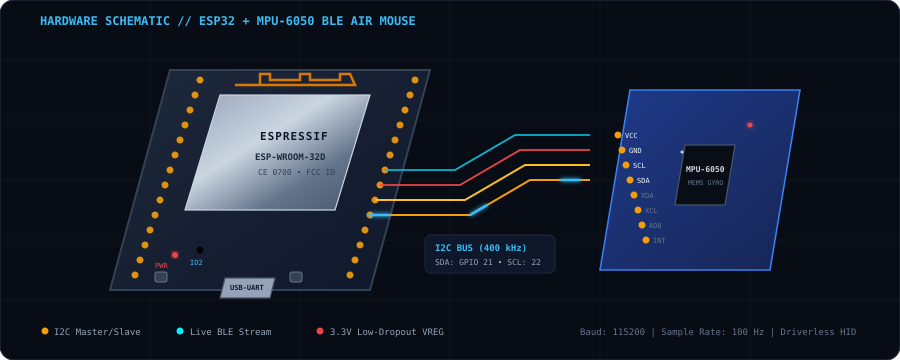

<div align="center">

<!-- ========================================================
     BESPOKE VIRTUAL DESKTOP: ARCH LINUX // HYPRLAND (WAYLAND)
     Rendered live with pure vector SVG and CSS animations
     ======================================================== -->


<br/>

[](https://education.github.com)
[](https://archlinux.org)
[](https://espressif.com)
[](https://python.org)

</div>

---

### 🧱 Engineering Bento Grid

<table>
<tr>
<td width="50%" valign="top">

#### 🔌 01 // Embedded Hardware & Firmware
* **ESP32 BLE Air Mouse**: Custom gesture interface translating 6-axis IMU gyro/accel data into driverless HID pointer events over Bluetooth Low Energy.
* **Bus Protocols**: Hands-on I2C clock sync (400 kHz) and sensor register polling with the MPU-6050.
* **Low-Level Control**: Real-time signal smoothing, dynamic deadzones, and tactile interrupt routines.

</td>
<td width="50%" valign="top">

#### 🐧 02 // Systems & Linux Environment
* **Daily Driver**: Arch Linux running Wayland compositor (Hyprland).
* **CLI & Tooling**: POSIX shell automation, fast keyboard-driven workflows, Neovim, and Git version control.
* **System Principles**: Process pipelines, file descriptors, Unix philosophy, and system-level performance.

</td>
</tr>
<tr>
<td width="50%" valign="top">

#### 🐍 03 // Algorithmic Engineering
* **Core Problem Solving**: Writing algorithmic logic from scratch on blank files without third-party shortcuts.
* **Key Domains**: Modulo arithmetic, digit extraction, recursive state exploration, and core data structures (Hash Maps, Sets, Arrays).
* **Engineering Standard**: Clean asymptotic time-space complexity and modular function design.

</td>
<td width="50%" valign="top">

#### 🤖 04 // Agentic AI & Modern Workflows
* **Local Inference**: Running and benchmarking edge LLMs locally via Ollama.
* **Agentic Tooling**: Leveraging autonomous AI agents and Model Context Protocol (MCP) to accelerate software iteration.
* **Hardware-AI Convergence**: Exploring lightweight inference models for embedded edge microcontrollers.

</td>
</tr>
</table>

---

### 🔬 Hardware Spotlight: ESP32 Bluetooth Air Mouse

<!-- Detailed Isometric Hardware PCB Vector Schematic -->
<div align="center">
  
</div>

<br/>

<details>
<summary><b>🔍 Click to inspect Signal Flow Architecture & Mathematical Filter</b></summary>
<br/>

```text
  [ PHYSICAL MOTION ]          [ MICROCONTROLLER ]                 [ BLUETOOTH BLE ]            [ HOST OS ]
 ┌─────────────────┐          ┌───────────────────────┐           ┌─────────────────┐          ┌──────────────┐
 │ MPU-6050 6-Axis │  I2C     │ ESP32 DevKit V1 Core  │   HID     │ BLE GATT Server │  Radio   │ Wayland Host │
 │ (Gyro + Accel)  ├─────────►│ - Low-pass EMA Filter ├──────────►│ (Mouse Report   ├─────────►│ Cursor Event │
 └─────────────────┘ 400 kHz  │ - Dynamic Deadzone    │  Reports  │  Descriptor)    │ 2.4 GHz  └──────────────┘
                              │ - Tactile Click Event │           └─────────────────┘
                              └───────────────────────┘
```

#### 📐 Mathematical Noise & Tremor Filter (Exponential Moving Average)
Raw MEMS gyroscopic output contains high-frequency thermal noise and micro-tremors from hand movement. To achieve glass-smooth cursor gliding without perceivable latency, raw angular velocities are filtered through an **Exponential Moving Average (EMA)**:

$$S_t = \alpha \cdot Y_t + (1 - \alpha) \cdot S_{t-1}$$

* $\alpha = 0.35$: Tuned responsiveness coefficient balance between latency ($<4\text{ ms}$) and jitter.
* **Dynamic Deadzone**: If $|S_t| < \text{threshold}$, $S_t = 0$ to eliminate involuntary drift when holding the hand still.

**Repository**: [`AGIQdev-Aditya/esp32-air-mouse`](https://github.com/AGIQdev-Aditya/esp32-air-mouse)

</details>

---

### 🎮 Interactive Sandbox (Terminal Playground)

<table>
<tr>
<td width="50%" valign="top">

#### 🕹️ Play Against Aditya's Bot (RPS v2)
*Click a move to trigger an instant round:*

<details>
<summary><b>✊ Throw Rock</b></summary>
<br/>
<blockquote>
🤖 <b>Aditya Bot:</b> ✋ Paper!<br/>
<i>Paper wraps rock — bot claims this round! Rematch? 😄</i>
</blockquote>
</details>

<details>
<summary><b>✋ Throw Paper</b></summary>
<br/>
<blockquote>
🤖 <b>Aditya Bot:</b> ✌️ Scissors!<br/>
<i>Scissors slice paper! Clean cut! Try again! ✂️</i>
</blockquote>
</details>

<details>
<summary><b>✌️ Throw Scissors</b></summary>
<br/>
<blockquote>
🤖 <b>Aditya Bot:</b> ✊ Rock!<br/>
<i>Rock smashes scissors! Better luck next turn! 💥</i>
</blockquote>
</details>

</td>
<td width="50%" valign="top">

#### 💻 Live CLI Query
*Click below to run virtual diagnostics:*

<details>
<summary><b>❯ run system_specs.sh</b></summary>
<br/>

```text
Kernel      : Linux 6.x (x86_64)
Compositor  : Hyprland (Wayland)
Shell       : Bash / Zsh
Terminal    : Alacritty / Foot
Primary Dev : Python 3.x, Embedded C, Bash
Hardware    : ESP32 DevKit, MPU-6050, Raspberry Pi
```

</details>

<details>
<summary><b>❯ ping guestbook</b></summary>
<br/>
<blockquote>
Want to leave a message, suggest a project, or say hi?<br/>
👉 <a href="https://github.com/AGIQdev-Aditya/AGIQdev-Aditya/issues/new?title=👋+Guestbook+Ping+from+Visitor&body=Hi+Aditya!+Just+checked+out+your+profile+and+wanted+to+say+hello!"><b>Click here to leave a Guestbook Ping (GitHub Issue)</b></a>
</blockquote>
</details>

</td>
</tr>
</table>

---

### 🛠️ Tooling & Technologies

<div align="center">

<a href="https://skillicons.dev">
  
</a>

</div>

---

### 💡 The Blueprint (How This Profile Was Engineered)

<details>
<summary><b>📐 How is this profile built? (For developers inspecting the source)</b></summary>
<br/>

> Most profiles rely on generic third-party generator iframes that break, throttle, or load slowly. This profile is engineered with:
> 1. **Handcrafted Animated Vector SVGs**: Both the top Hyprland virtual desktop banner and the isometric hardware PCB schematic are pure vector SVGs with embedded CSS `@keyframes` animations—no JavaScript, zero external dependencies, 100% compliant with GitHub's strict sanitization engine.
> 2. **Native Markdown Bento Grid**: Lightweight, responsive HTML tables that adapt cleanly to both mobile and desktop screens.
> 3. **Mathematical Hardware Formulations**: Real signal filtering equations rendered via GitHub's native LaTeX KaTeX math engine.
>
> Feel free to inspect the raw markdown or fork the SVG assets to build your own!

</details>

---

### 📬 Connect

<div align="center">

[](https://github.com/AGIQdev-Aditya)
[](mailto:agiq.dev@gmail.com)
[](mailto:adityasharma8ti@gmail.com)

</div>
