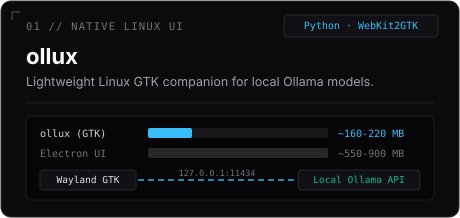
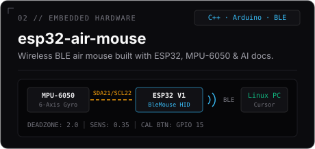
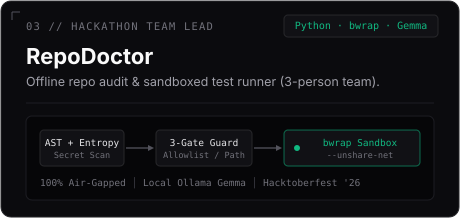
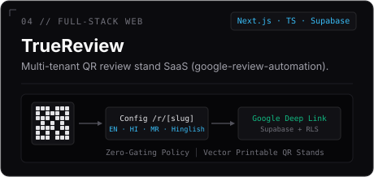
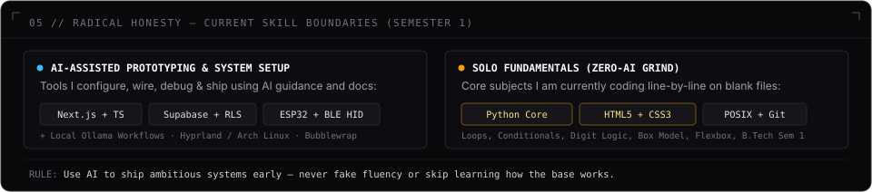

<div align="center">



<br/><br/>

<a href="https://github.com/AGIQdev-Aditya/ollux"></a>&nbsp;<a href="https://github.com/AGIQdev-Aditya/esp32-air-mouse"></a>
<br/>
<a href="https://github.com/AGIQdev-Aditya/RepoDoctor"></a>&nbsp;<a href="https://github.com/AGIQdev-Aditya/google-review-automation"></a>

<br/><br/>



</div>

<br/>

<details>
<summary><code>❯ cat /etc/workbench</code> &nbsp;—&nbsp; Linux Environment &amp; Physical Hardware Bench</summary>
<br/>

```text
Workstation  : Dell Precision 7540 (Intel Core i7-9850H · 31 GiB RAM · Quadro T1000)
OS / Kernel  : Arch Linux (Omarchy) · Linux 7.2.15-4-omarchy
Compositor   : Hyprland (Wayland)
Hardware Lab : ESP32 DevKit V1 · MPU-6050 6-Axis IMU · Raspberry Pi 4B · Arduino
Local AI     : Ollama (offline inference & tooling experiments)
```

</details>

<details>
<summary><code>❯ ls -la ~/repos</code> &nbsp;—&nbsp; Complete Public Repository Index (11 Repos)</summary>
<br/>

| Repository | Category | Honest Scope |
| :--- | :--- | :--- |
| [`ollux`](https://github.com/AGIQdev-Aditya/ollux) | Linux Desktop | Native Python + WebKit2GTK companion UI for local Ollama (~160–220 MB RAM). |
| [`esp32-air-mouse`](https://github.com/AGIQdev-Aditya/esp32-air-mouse) | Hardware | ESP32 + MPU-6050 BLE HID air mouse wired & calibrated with Arduino IDE + AI docs. |
| [`RepoDoctor`](https://github.com/AGIQdev-Aditya/RepoDoctor) | Hackathon (Lead) | Hacktoberfest '26 team project (3 devs): offline AST audit + Bubblewrap test sandbox. |
| [`google-review-automation`](https://github.com/AGIQdev-Aditya/google-review-automation) | Full-Stack Web | *TrueReview*: Next.js + TypeScript + Supabase multi-tenant QR stand SaaS. |
| [`NexcanAI`](https://github.com/AGIQdev-Aditya/NexcanAI) | Full-Stack Web | Industrial visual inspection prototype using React, Node.js & Gemini multimodal. |
| [`CropPilotAI`](https://github.com/AGIQdev-Aditya/CropPilotAI) | Full-Stack Web | Hackathon prototype for crop pathology diagnostics (React, Express, Supabase, Gemini). |
| [`niat-clone-demo`](https://github.com/AGIQdev-Aditya/niat-clone-demo) | Frontend | UI clone sprint exploring responsive HTML/CSS structure for campus platform. |
| [`python-self-learning`](https://github.com/AGIQdev-Aditya/python-self-learning) | Fundamentals | Zero-AI blank-file grind: loops, conditionals, logic drills, data structures. |
| [`python-journey`](https://github.com/AGIQdev-Aditya/python-journey) | Fundamentals | Early Semester 1 Python experiments & daily exercises. |
| [`html-css-learning`](https://github.com/AGIQdev-Aditya/html-css-learning) | Fundamentals | Semantic HTML5, Box Model, Flexbox, CSS Grid & viva practical drills. |
| [`AGIQdev-Aditya`](https://github.com/AGIQdev-Aditya/AGIQdev-Aditya) | Profile | Custom animated vector SVG architecture (zero external widgets). |

</details>

<br/>

<div align="center">

[](https://github.com/AGIQdev-Aditya)
[](mailto:agiq.dev@gmail.com)
[](https://github.com/AGIQdev-Aditya/AGIQdev-Aditya/issues/new?title=Note+from+GitHub+Visitor&body=Hey+Aditya!)

</div>
